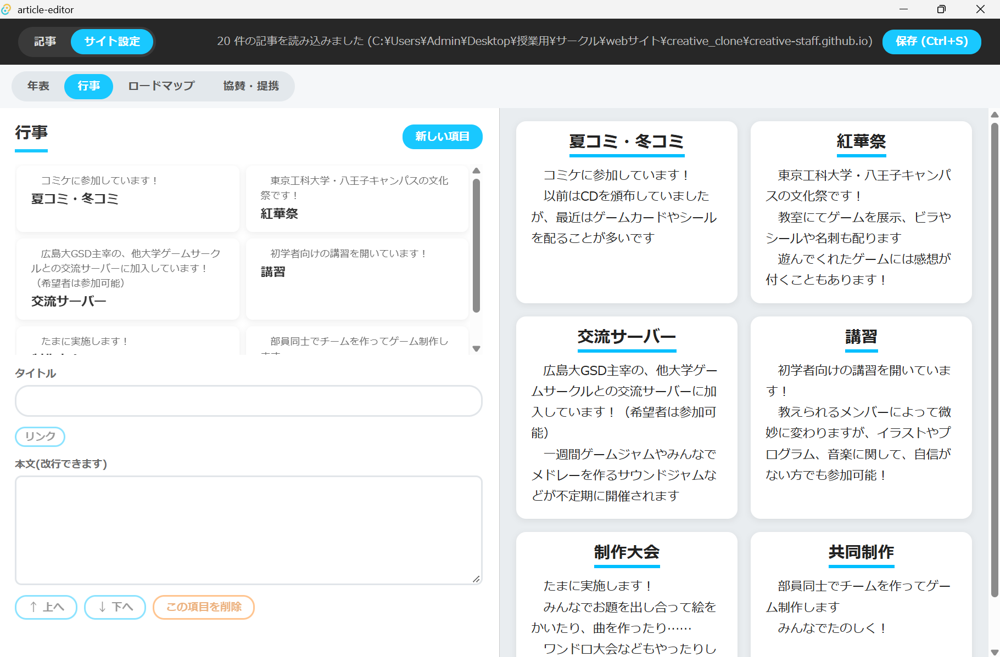
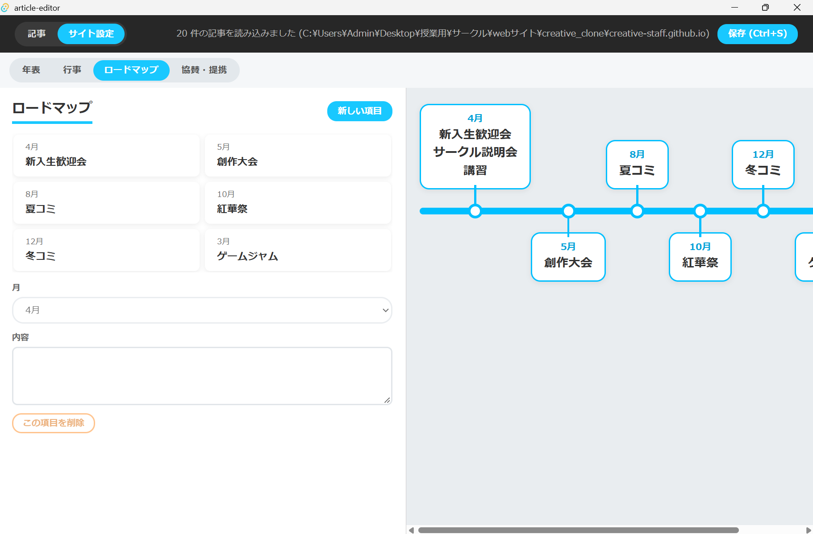

# 概要
　[クリエイティブスタッフ](https://www.creative-staff.com/)のウェブサイト（主に記事）を編集するためのツールです  

- 記事編集
- サイト設定
  - 年表
  - イベント
  - 年間ロードマップ
  - 協賛・提携

を編集できます  
　利用するには[クリエイティブスタッフのプロジェクト](https://github.com/Creative-Staff/creative-staff.github.io)が必要です

# 使い方

## 記事編集画面

## サイト設定画面

