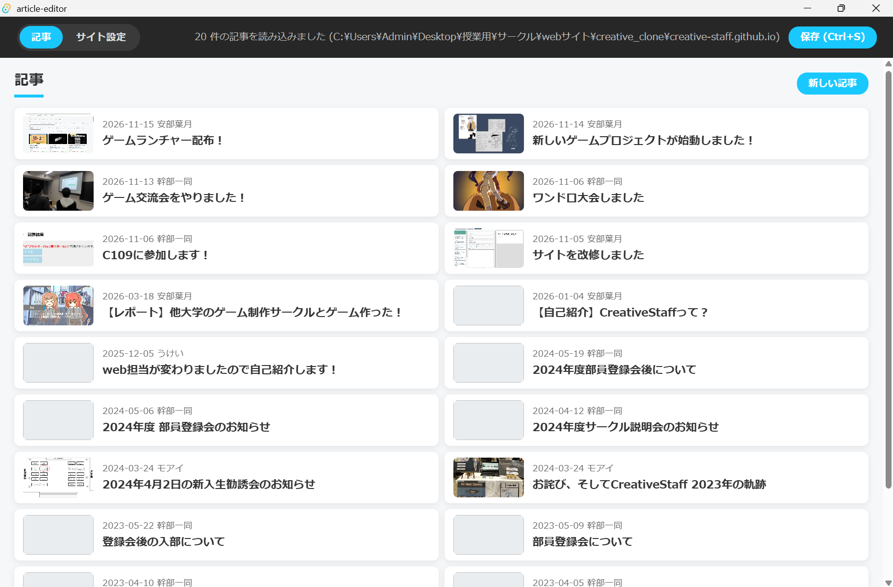
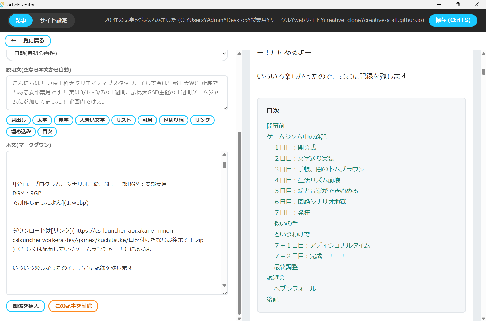
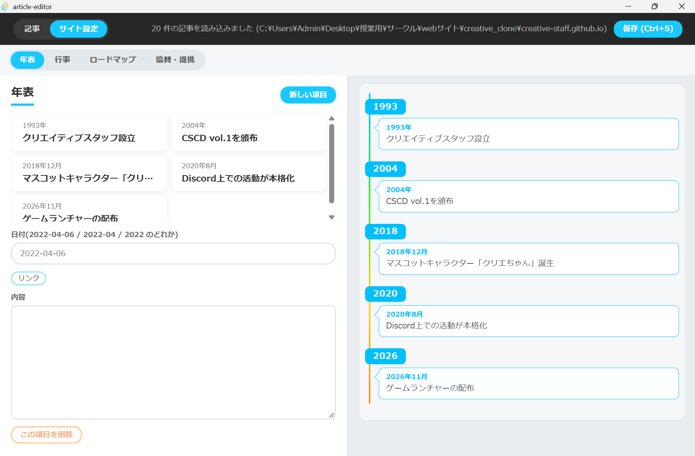
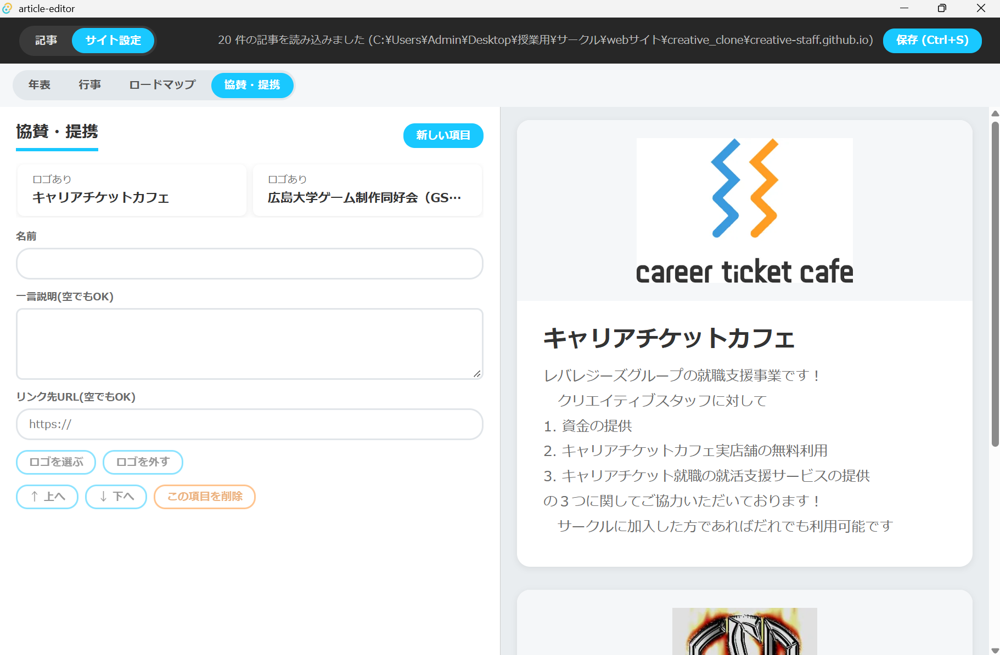

# 概要
　[クリエイティブスタッフ](https://www.creative-staff.com/)のウェブサイト（主に記事）を編集するためのツールです  

- 記事編集
- サイト設定
  - 年表
  - イベント
  - 年間ロードマップ
  - 協賛・提携

を編集できます  
　利用するには[クリエイティブスタッフのプロジェクト](https://github.com/Creative-Staff/creative-staff.github.io)が必要です

# 使い方

## 記事編集画面

　記事を新しく作る場合は「新しい記事」、取り込む場合は「取り込む」を押して出力した記事のzipを入れます  
　出力に関しては後述します  
　編集する場合は一覧に表示された記事をクリック

  

 

　記事はマークダウン形式で記述します  
　一部はボタンによって追加できます（使わなくても追加は可能）  
　書き出しによって記事をzip形式で出力できます

  

 

## サイト設定画面
### サークル年表

  

 

### イベント

  

 

### 年間ロードマップ

  

 

### 協賛・提携

  

 